# 📩 SMS Spam Detector

**A machine-learning system that classifies SMS messages as spam or ham (legitimate), with a deployed Streamlit app, a full evaluation, an error analysis and a test on Nigerian-context messages.**


[](YOUR-APP-URL)

> Capstone project, **Tech4Youth Advanced ICT Skills Training Programme** (Machine Learning / AI track).
> Author:   **ANIUDE PAUL IFEANYI** 

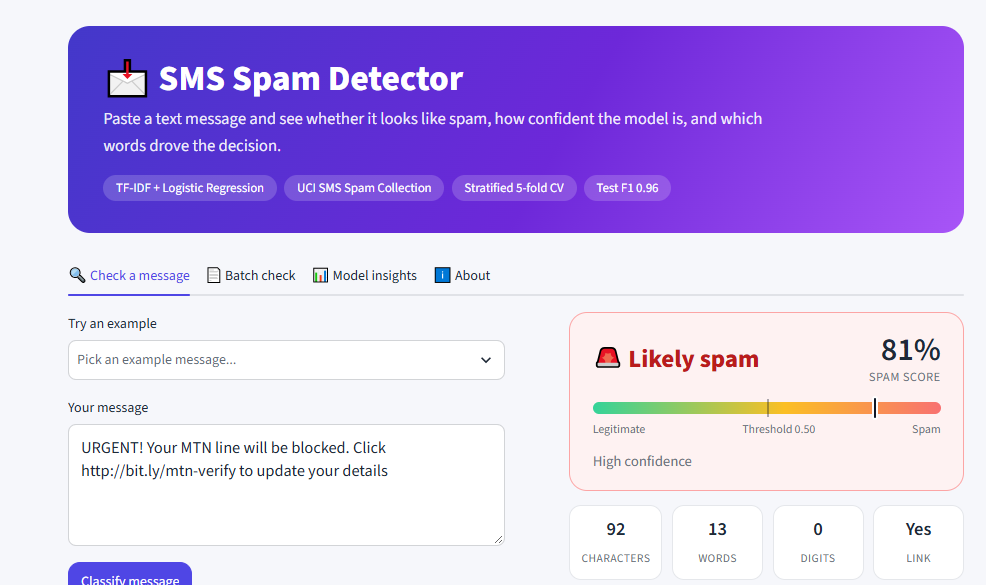


---

## Table of contents

1. [Project at a glance](#1-project-at-a-glance)
2. [Problem statement](#2-problem-statement)
3. [Dataset](#3-dataset)
4. [Methodology](#4-methodology)
5. [Exploratory data analysis](#5-exploratory-data-analysis)
6. [Results](#6-results)
7. [Error analysis](#7-error-analysis)
8. [What the model learned](#8-what-the-model-learned)
9. [Testing on Nigerian-context messages](#9-testing-on-nigerian-context-messages)
10. [The Streamlit app](#10-the-streamlit-app)
11. [Limitations and ethical notes](#11-limitations-and-ethical-notes)
12. [Future work](#12-future-work)
13. [Repository structure](#13-repository-structure)
14. [How to run it](#14-how-to-run-it)
15. [Tech stack](#15-tech-stack)
16. [References, license and acknowledgements](#16-references-license-and-acknowledgements)

---

## 1. Project at a glance

| | |
|---|---|
| **Task** | Binary text classification: spam vs ham |
| **Data** | UCI SMS Spam Collection (5,574 labelled English messages) |
| **Pipeline** | Text cleaning → TF-IDF (unigrams and bigrams) → classifier |
| **Models compared** | Multinomial Naive Bayes, Logistic Regression, Linear SVM |
| **Validation** | Stratified 5-fold cross-validation with grid search |
| **Final model** | Logistic Regression (best cross-validated F1) |
| **Test accuracy** | **99.0%** |
| **Spam precision / recall / F1** | **0.976 / 0.945 / 0.960** |
| **Errors on 1,031 test messages** | 3 false positives, 7 false negatives |
| **Deployment** | Streamlit app with single-message and batch modes |

**Headline result.** On a held-out test set of 1,031 messages, the final model caught 121 of 128 spam messages and wrongly flagged only 3 of 903 legitimate ones. The project also documents where the model fails and how it behaves on Nigerian-style messages it was never trained on.

---

## 2. Problem statement

Spam SMS wastes time, and the worst of it is fraud: fake prize notices, fake account warnings and links that steal details. A useful filter must do two things at once:

- **catch spam** (high recall), and
- **avoid hiding real messages** (high precision), because a legitimate message sent to the spam folder, such as a bank alert or a note from a friend, can cost more than a spam message that slips through.

Because only about 12–13% of messages are spam, **accuracy alone is misleading**: a model that labels everything "ham" would score about 87% and catch nothing. This project therefore reports precision, recall and F1 for the spam class, and uses stratified sampling and class weighting throughout.

---

## 3. Dataset

| | |
|---|---|
| **Name** | SMS Spam Collection |
| **Source** | [UCI Machine Learning Repository](https://archive.ics.uci.edu/dataset/228/sms+spam+collection) |
| **Creators** | Tiago A. Almeida and José María Gómez Hidalgo |
| **License** | CC BY 4.0 |
| **Raw size** | 5,574 messages: 4,827 ham (86.6%) and 747 spam (13.4%) |
| **After removing duplicates and empty messages** | **N rows = 5160, with ham count = 4518 and spam counts = 642** |
| **Train / test split** | **[train rows]** / 1,031 rows (stratified 80/20); the test set has 128 spam messages (12.42%) |
| **Format** | Tab-separated file: label, then message text; converted to CSV in Notebook 1 |

**Data-quality steps** (Notebook 1 and 3):

- **Exact duplicates were removed** before splitting, so the same message can never appear in both train and test (that would inflate the scores). I also checked for duplicates with conflicting labels. **[Messages with conflicting labels: 0]**
- **9 messages became empty after cleaning**, for example messages containing only stopwords or symbols. They were dropped because there is nothing for the model to learn from; this is under 0.2% of the data.

---

## 4. Methodology

### 4.1 Pipeline overview

```mermaid
flowchart LR
    A["Raw SMS Spam Collection<br/>5,574 messages"] --> B["Remove duplicates<br/>(before any split)"]
    B --> C["Text cleaning<br/>tokens, stopwords, stemming"]
    C --> D["Drop empty messages"]
    D --> E["Stratified 80/20<br/>train / test split"]
    E --> F["TF-IDF<br/>unigrams + bigrams<br/>(fit on train only)"]
    F --> G["Naive Bayes<br/>Logistic Regression<br/>Linear SVM"]
    G --> H["Stratified 5-fold CV<br/>+ grid search"]
    H --> I["Select best model<br/>by CV F1"]
    I --> J["Evaluate once<br/>on the test set"]
    J --> K["Streamlit app"]
```

### 4.2 Text preprocessing

Implemented in `src/preprocessing.py` (`clean_text`) and used identically in the notebooks and the app.

| Step | Example | Why |
|---|---|---|
| Decode HTML entities and strip tags | `&lt;#&gt;` → removed | The raw data contains encoding artefacts |
| Replace links with `urltoken` | `www.example.com` → `urltoken` | Spam often has links; the exact address is not informative |
| Replace long digit strings with `phonetoken` | `09061701461` → `phonetoken` | Phone numbers and short codes are a spam signal, their digits are not |
| Replace £ / $ / € amounts with `currencytoken` | `£900` → `currencytoken` | Prize amounts are a spam signal |
| Replace remaining numbers with `numtoken` | `24` → `numtoken` | Keeps "contains a number" without memorising values |
| Lower-case, remove punctuation and symbols | `WINNER!!` → `winner` | Reduces vocabulary size |
| Remove English stopwords and single characters | `you have won` → `won` | Removes words that carry little meaning |
| Porter stemming | `claiming` → `claim` | Merges word variants |

### 4.3 Feature extraction

TF-IDF with unigrams and bigrams (`ngram_range` searched over (1,1) and (1,2)), sublinear term-frequency scaling, and a minimum document frequency tuned by grid search. **The vectorizer is fitted on the training data only** and, during cross-validation, is refitted inside each fold through a scikit-learn `Pipeline`, so no information from the validation data leaks into training.

### 4.4 Handling class imbalance

Spam is about 12–13% of the data. The imbalance was handled with:

1. **Stratified train/test split**: both sets keep the same spam share (≈12.4% in the test set).
2. **Stratified 5-fold cross-validation**: every fold keeps the same ratio.
3. **Class-weighted training** (`class_weight="balanced"`) for Logistic Regression and Linear SVM. Naive Bayes already models class priors; its smoothing parameter was tuned instead.
4. **Imbalance-aware metrics**: precision, recall and F1 for the spam class, plus precision-recall curves.

### 4.5 Models and tuning

Three classical models were compared. They are fast, work well on sparse TF-IDF features, and the two linear ones are interpretable.

| Model | Tuned hyperparameters (grid) | Best values found |
|---|---|---|
| Multinomial Naive Bayes | `alpha` ∈ {0.01, 0.05, 0.1, 0.5, 1.0}; n-grams; `min_df` ∈ {1, 2, 3} | **[ {'clf__alpha': 0.1, 'tfidf__min_df': 1, 'tfidf__ngram_range': (1, 2)}]** |
| Logistic Regression | `C` ∈ {0.5, 1, 5, 10, 50}; n-grams; `min_df` ∈ {1, 2, 3} | **[ {'clf__C': 50, 'tfidf__min_df': 3, 'tfidf__ngram_range': (1, 1)}]** |
| Linear SVM | `C` ∈ {0.1, 0.5, 1, 2, 5}; n-grams; `min_df` ∈ {1, 2, 3} | **[ {'clf__C': 5, 'tfidf__min_df': 1, 'tfidf__ngram_range': (1, 2)}]** |

Grid searches were scored by **F1 on the spam class** using stratified 5-fold cross-validation on the training set only.

### 4.6 Model selection

The final model was chosen by **cross-validated F1** on the training data, not by test-set performance. The test set was used once, at the end, to report results. This avoids making the test score optimistic.

---

## 5. Exploratory data analysis

*Notebook: `02_exploratory_data_analysis.ipynb`*

### Class distribution

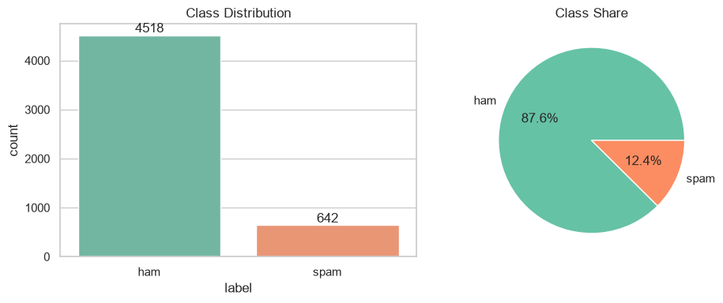

Spam makes up only about one in eight messages, which is why accuracy alone is not enough and why stratification matters.

### Message length and structure

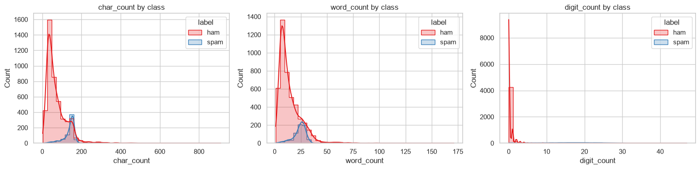

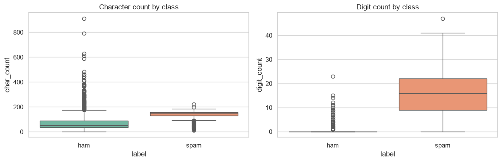

Spam messages tend to be **longer**, contain **more digits**, use **more capital letters**, and more often include **currency symbols and links** than ham. Exact numbers from the notebook:


### Most frequent words

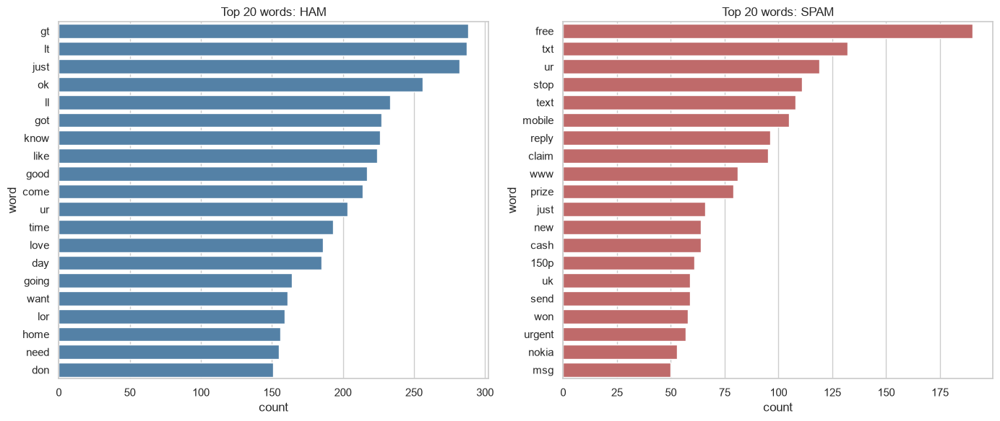

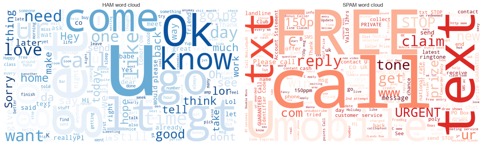

Ham is dominated by everyday conversational words, while spam is dominated by calls to action and offers (typically words such as *free*, *call*, *txt*, *claim*, *prize*, *reply*, *stop*).

---

## 6. Results

*Notebooks: `04_model_training_and_tuning.ipynb`, `05_evaluation_and_error_analysis.ipynb`*

All figures below are on the **held-out test set (1,031 messages: 903 ham and 128 spam)**.

### 6.1 Baseline models (before tuning)

| Model | Spam precision | Spam recall | Spam F1 |
|---|---|---|---|
| Naive Bayes | 0.99 | 0.76 | 0.86 |
| Logistic Regression | 0.96 | 0.95 | 0.96 |
| Linear SVM | 0.98 | 0.93 | 0.95 |

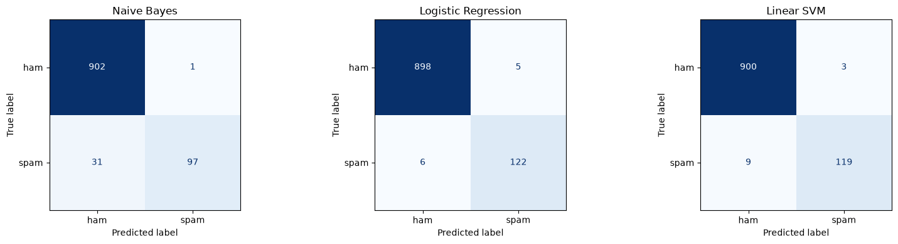

Naive Bayes was very precise but missed about a quarter of the spam: with default smoothing it only flags messages it is very sure about. This was a tuning problem rather than a model problem.

### 6.2 Cross-validation (training data, 5 stratified folds)

| Model (tuned) | CV F1 (spam) |
|---|---|
| **Logistic Regression** | **0.9470** |
| Linear SVM | 0.9458 |
| Naive Bayes | 0.9425 |

The three models are within about half a point of each other, so cross-validation alone cannot separate them decisively. Logistic Regression had the highest score.

### 6.3 Tuned models on the test set

| Model | Accuracy | Precision (spam) | Recall (spam) | F1 (spam) |
|---|---|---|---|---|
| **Logistic Regression (tuned)** | **0.9903** | 0.9758 | **0.9453** | **0.9603** |
| Linear SVM (tuned) | 0.9874 | 0.9752 | 0.9219 | 0.9478 |
| Naive Bayes (tuned) | 0.9874 | **0.9832** | 0.9141 | 0.9474 |

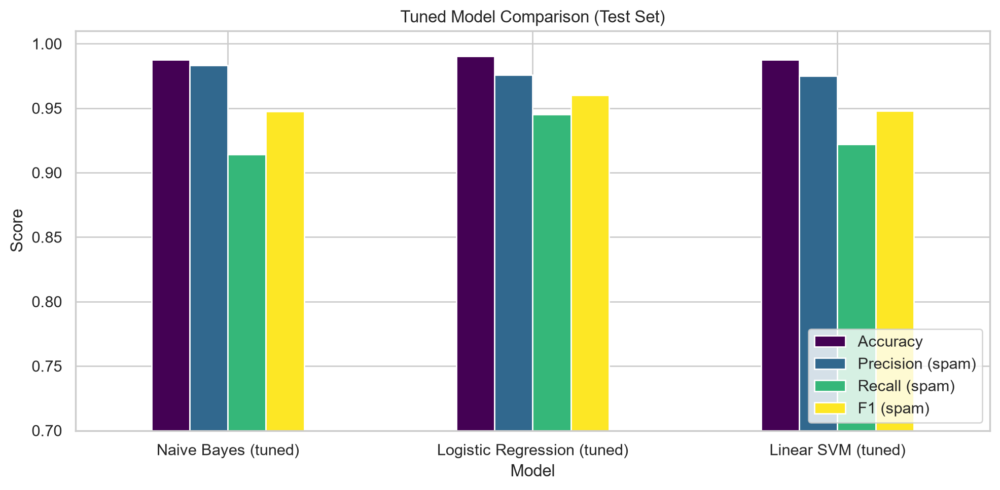

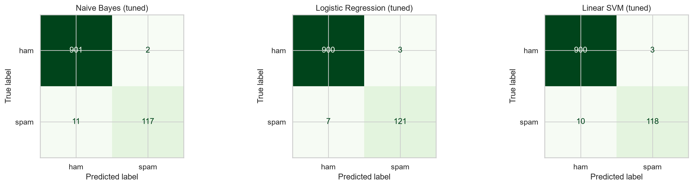

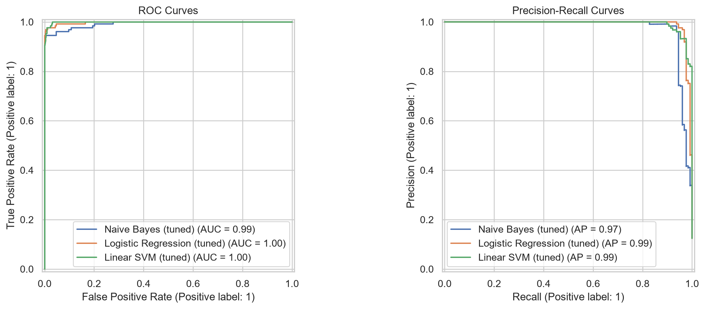

**Reading the results**

- **Tuning fixed Naive Bayes**: its spam recall rose from 0.76 to 0.91, confirming that smoothing was the issue.
- **Logistic Regression is the best overall**, by both cross-validation and the test set, so the choice is not a result of looking at the test set.
- **The differences between models are small.** With only 128 spam messages in the test set, one message is about 0.8 points of recall. The honest conclusion is that all three models are competitive, and Logistic Regression is the best by a small margin.
- **The precision-recall curve is more informative than the ROC curve** here; with ~12% spam, ROC curves look good for almost any model.

**Final model, confusion matrix (test set)**

| | Predicted ham | Predicted spam |
|---|---|---|
| **Actual ham (903)** | 900 | 3 |
| **Actual spam (128)** | 7 | 121 |

I chose **Logistic Regression** as the final model because it has the best cross-validated and test F1, it is interpretable (see section 8), and it outputs probabilities, which the app uses for a spam score and an adjustable threshold.

---

## 7. Error analysis

*Notebook: `05_evaluation_and_error_analysis.ipynb`*

The final model made 10 errors on 1,031 messages. Reading them is more informative than the headline score. The reasons below are my interpretation of the messages, not proven causes.

### False positives: legitimate messages flagged as spam (3)

| Message | Likely reason |
|---|---|
| "Hey...Great deal...Farm tour 9am to 5pm $95/pax, $50 deposit by 16 May" | Reads like a promotion: "deal", a price, a deposit and a deadline. A genuine ham/promotion ambiguity. |
| "S.this will increase the chance of winning." | "Chance" and "winning" are strong prize-scam words; the message itself is casual. |
| "I love to wine and dine my lady!" | No obvious trigger. Words such as "love" and "lady" are common in dating-line spam. |

### False negatives: spam that was missed (7)

**Spam written like a personal message (4):**

| Message (shortened) | Likely reason |
|---|---|
| "dating: i have had two of these. Only started after i sent a text to talk sport radio..." | Chat-line spam in a conversational tone with few spam keywords. |
| "Guess who am I? This is the first time I created a web page ... I want to be your friend" | Friendly personal wording; the only signal is the web link. |
| "Sorry I missed your call let's talk when you have the time. I'm on 07090201529" | Looks like an ordinary callback message; the phone number is the only clue. |
| "thesmszone.com lets you send free anonymous and masked messages..." | Chatty wording, and the label itself is debatable. |

**Spam written like a service notification (3):**

| Message (shortened) | Likely reason |
|---|---|
| "LookAtMe!: Thanks for your purchase of a video clip... charged 35p ... MMS to 32323" | Looks like a transactional receipt; the "35p" price is not covered by the currency pattern. |
| "Monthly password for wap. mobsi.com is 391784. Use your wap phone not PC." | Looks like a normal password message. |
| "Welcome! Please reply with your AGE and GENDER to begin. e.g 24M" | A short subscription prompt with almost no trigger words. |

### Takeaways

- **Most errors are missed spam (7 of 10).** The model is cautious: it rarely raises a false alarm (3 of 903 ham messages) but misses spam that does not look like spam. Messages that imitate personal texts or service notifications give a bag-of-words model very few distinctive words to learn from.
- **The false positives share one cause:** ordinary messages that contain commercial or prize vocabulary.
- **Some labels are debatable**, so a small share of these "errors" would be hard even for a human.
- **Preprocessing gaps found:** domains without `http` or `www` (for example `thesmszone.com`, `mobsi.com`), prices in pence (`35p`), and short codes written as plain numbers (`32323`) are not handled specially.

---

## 8. What the model learned

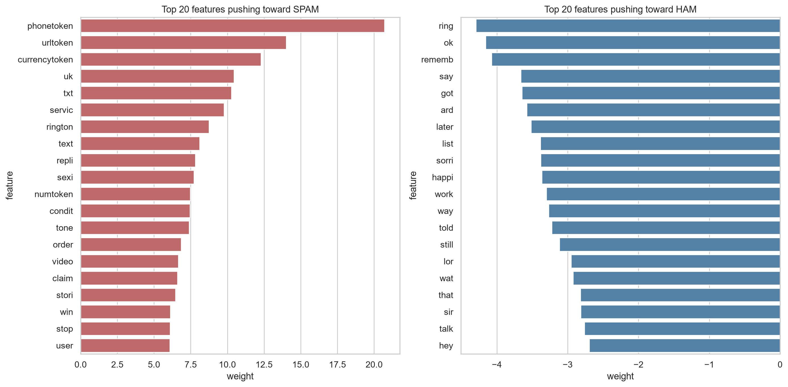

The chart shows the words (after stemming) with the largest weights toward spam and toward ham. Spam is driven by offers, calls to action and the special tokens from preprocessing (`numtoken`, `phonetoken`, `currencytoken`, `urltoken`), while ham is driven by conversational words.

The app shows the same information for each message you enter: the words that pushed its score up or down.

---

## 9. Testing on Nigerian-context messages

*Notebook: `06_custom_message_testing.ipynb`*

The training data is mostly UK and Singapore English, so I tested the final model on **20 messages I wrote myself** in four groups: Nigerian-style scams, legitimate Nigerian bank and telecom messages, pidgin and casual chat, and standard English (with two UK-style spam messages as a control). The expected label was fixed before running the model.

| Category | Correct | Total | Accuracy |
|---|---|---|---|
| Nigerian scam / spam | 7 | 7 | 1.00 |
| Nigerian bank / telecom (legitimate) | 3 | 4 | 0.75 |
| Pidgin / casual | 4 | 4 | 1.00 |
| Standard English ham | 3 | 3 | 1.00 |
| UK-style spam (control) | 2 | 2 | 1.00 |
| **Overall** | **19** | **20** | **95%** |

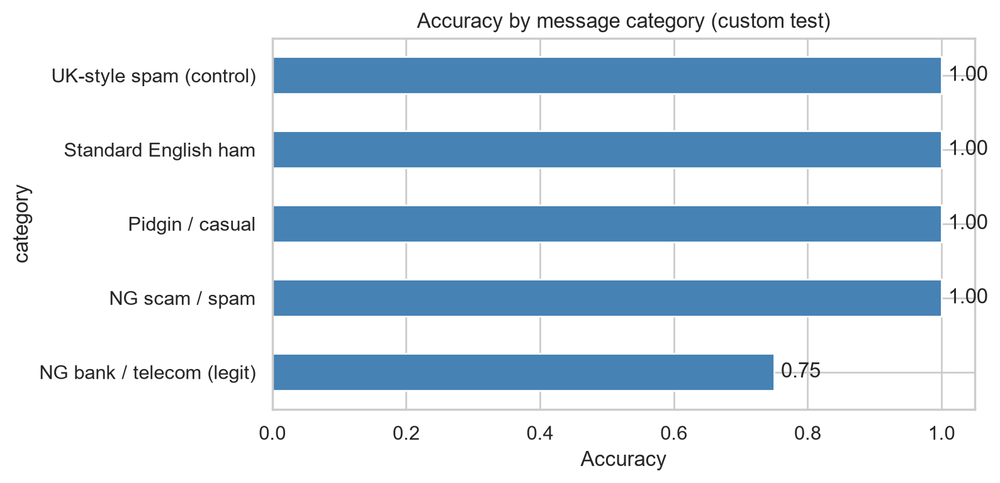

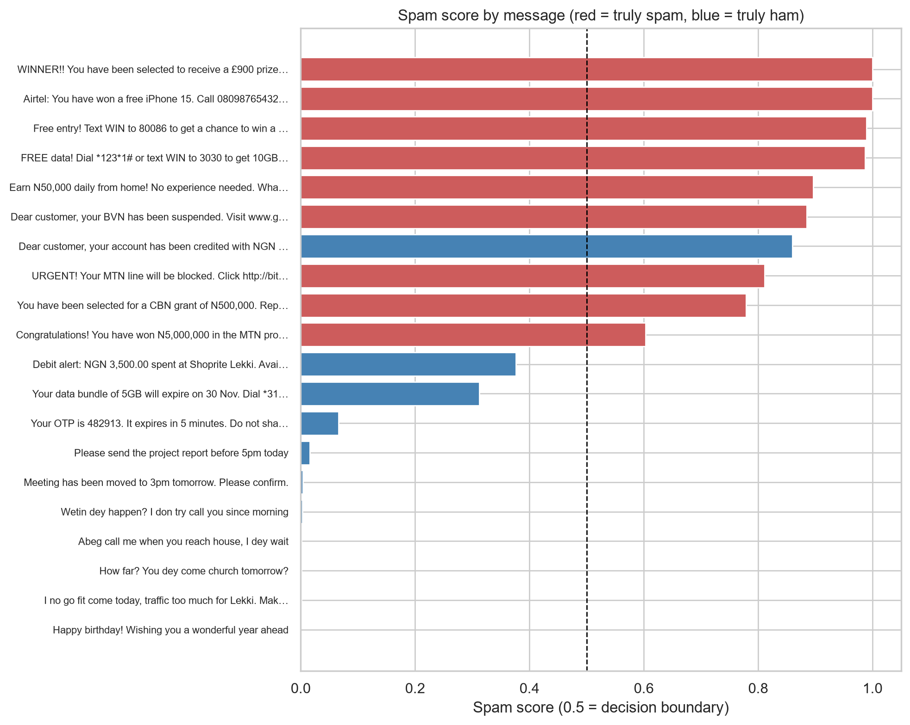

**The one error** was a legitimate bank credit alert (*"Dear customer, your account has been credited with NGN 25,000. Bal: NGN 40,200"*), flagged as spam with a high score (0.86). Its wording ("dear customer", "account", "credit") resembles spam phrasing in the training data, and `NGN` amounts are not recognised as currency. A debit alert, an OTP message and a data-bundle notice were classified correctly, so the picture is mixed rather than a blanket failure on bank alerts.

**How far to trust this test.** It is a small, informal probe, not a benchmark. I wrote the messages, and the scam examples contain obvious trigger words ("won", "claim", "free", "prize"); real scams are often subtler. The pidgin messages were probably classified as ham because they contain no spam words, not because the model understands pidgin. I treat the result as an illustration of **domain shift**, and it motivates the future work below.

---

## 10. The Streamlit app

**Live demo:** [APP-URL](https://sms-spam-detector-solution.streamlit.app)

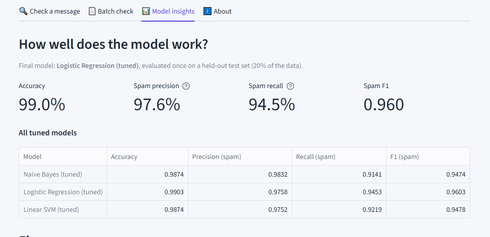

| Feature | Description |
|---|---|
| **Check a message** | Paste a message or pick an example; get a verdict, a spam score on a colour meter, a confidence label and message facts (length, digits, link) |
| **Explainability** | Shows the words that pushed the score up or down and the cleaned text the model received |
| **Adjustable threshold** | Sidebar slider (0.30–0.90): raise it for fewer false alarms, lower it to catch more spam |
| **Batch check** | Upload a CSV, score every row, sort by spam score and download the results |
| **Model insights** | Test metrics and the evaluation figures from this README |
| **Edge cases handled** | Empty input, messages with no informative words after cleaning, empty or large CSV files |
| **Privacy** | Messages are scored in memory and are not stored |

The app loads one file, `models/spam_pipeline.pkl`, which contains the fitted TF-IDF vectorizer and the classifier, and uses the same `clean_text` function as the notebooks.

---

## 11. Limitations and ethical notes

- **Domain shift.** The data is mostly UK and Singapore English from before 2012. Nigerian bank alerts, local short codes, Naira amounts and pidgin are outside the training data, and modern scams (WhatsApp links, mobile-money fraud) are not represented.
- **Style-based evasion.** Spam written like a personal message or a service notification is hard for a bag-of-words model, and a spammer who knows the typical trigger words can avoid them.
- **Label noise.** A few messages in the dataset are ambiguous or arguably mislabelled.
- **Small test set.** With 128 spam messages in the test set, differences of a point or so between models are within noise.
- **Cost of errors.** A false positive can hide a legitimate bank alert or OTP. The app's adjustable threshold lets a user trade recall for precision, but the model should be a decision aid, not the only safeguard.
- **Privacy.** The dataset contains real SMS messages collected from public sources and studies. The app does not store the messages users enter.

---

## 12. Future work

- **Collect and label Nigerian SMS data** (with consent and anonymisation), then retrain or fine-tune.
- **Improve preprocessing** using the gaps found in the error analysis: detect bare domains, pence prices, `NGN` / `₦` amounts and short codes.
- **Add hand-crafted features**: message length, digit ratio, capital-letter ratio, link and phone-number flags.
- **Try deep-learning and transformer models** (LSTM, or a pretrained multilingual model) and compare them with the classical baseline.
- **Threshold tuning** on cross-validated predictions to favour precision, then document the operating point.
- **Monitoring and feedback**: let users report wrong predictions and retrain periodically.

---

## 13. Repository structure

```
sms-spam-detector/
├── app.py                              # Streamlit app
├── requirements.txt
├── README.md
├── .streamlit/
│   └── config.toml                     # app theme
├── data/
│   ├── SMSSpamCollection               # original UCI file
│   ├── sms_spam.csv                    # converted CSV
│   └── processed/                      # generated by the notebooks (not tracked)
├── notebooks/
│   ├── 01_data_loading_and_cleaning.ipynb
│   ├── 02_exploratory_data_analysis.ipynb
│   ├── 03_text_preprocessing_and_split.ipynb
│   ├── 04_model_training_and_tuning.ipynb
│   ├── 05_evaluation_and_error_analysis.ipynb
│   └── 06_custom_message_testing.ipynb
├── src/
│   ├── __init__.py
│   └── preprocessing.py                # clean_text, shared by notebooks and app
├── models/
│   ├── spam_pipeline.pkl               # final model (TF-IDF + Logistic Regression)
│   └── cv_scores.csv
└── reports/
    ├── final_test_results.csv
    └── figures/                        # all figures used in this README
```

---

## 14. How to run it

**Requirements:** Python 3.10 or newer.

```bash
# 1. Clone the repository
git clone https://github.com/Aniude-tech/sms-spam-detector.git
cd sms-spam-detector

# 2. Create and activate a virtual environment
python -m venv .venv
# Windows (PowerShell):  .venv\Scripts\Activate.ps1
# macOS / Linux:         source .venv/bin/activate

# 3. Install dependencies
pip install -r requirements.txt

# 4. Run the app
streamlit run app.py
```

The first run downloads the small NLTK resources (`punkt`, `punkt_tab`, `stopwords`) automatically.

**To reproduce the analysis**, install the notebook extras and run the notebooks in order. Each notebook saves what the next one needs:

```bash
pip install matplotlib seaborn wordcloud jupyter
```

| Order | Notebook | Reads | Writes |
|---|---|---|---|
| 1 | `01_data_loading_and_cleaning` | `data/sms_spam.csv` | `data/processed/sms_dedup.csv` |
| 2 | `02_exploratory_data_analysis` | `sms_dedup.csv` | figures |
| 3 | `03_text_preprocessing_and_split` | `sms_dedup.csv` | `train.csv`, `test.csv` |
| 4 | `04_model_training_and_tuning` | `train.csv`, `test.csv` | tuned models, `cv_scores.csv` |
| 5 | `05_evaluation_and_error_analysis` | tuned models, `test.csv` | `spam_pipeline.pkl`, results table, figures |
| 6 | `06_custom_message_testing` | `spam_pipeline.pkl` | custom test results, figures |

All random operations use `random_state=42`.

**Deployment.** The app is deployed on Streamlit Community Cloud from the `main` branch with `app.py` as the entry point. `scikit-learn` is pinned in `requirements.txt` to the version used for training, because a pickled model should be loaded with the same version.

---

## 15. Tech stack

Python · pandas · NumPy · scikit-learn · NLTK · Matplotlib · Seaborn · WordCloud · joblib · Streamlit · Jupyter · Git and GitHub

---

## 16. References, license and acknowledgements

**Dataset.** Almeida, T. A., Gómez Hidalgo, J. M., and Yamakami, A. (2011). *Contributions to the study of SMS spam filtering: new collection and results.* Proceedings of the 11th ACM Symposium on Document Engineering (DocEng '11), pp. 259–262. Available from the [UCI Machine Learning Repository](https://archive.ics.uci.edu/dataset/228/sms+spam+collection) under CC BY 4.0.

**License.** Code: **MIT**

**Acknowledgements.** Built as part of the Tech4Youth Advanced ICT Skills Training Programme. Thanks to the programme team and my own very tutor Sir Nedu.
